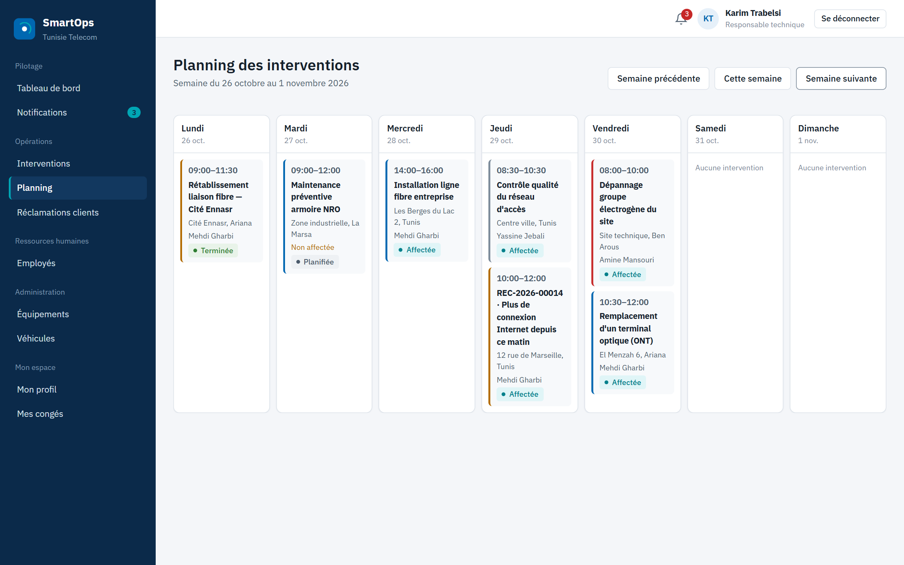
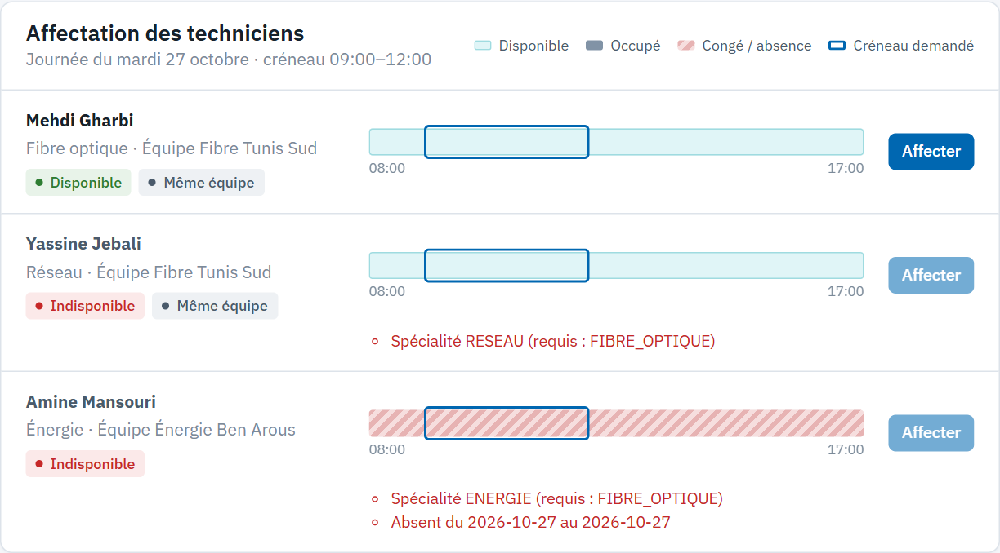
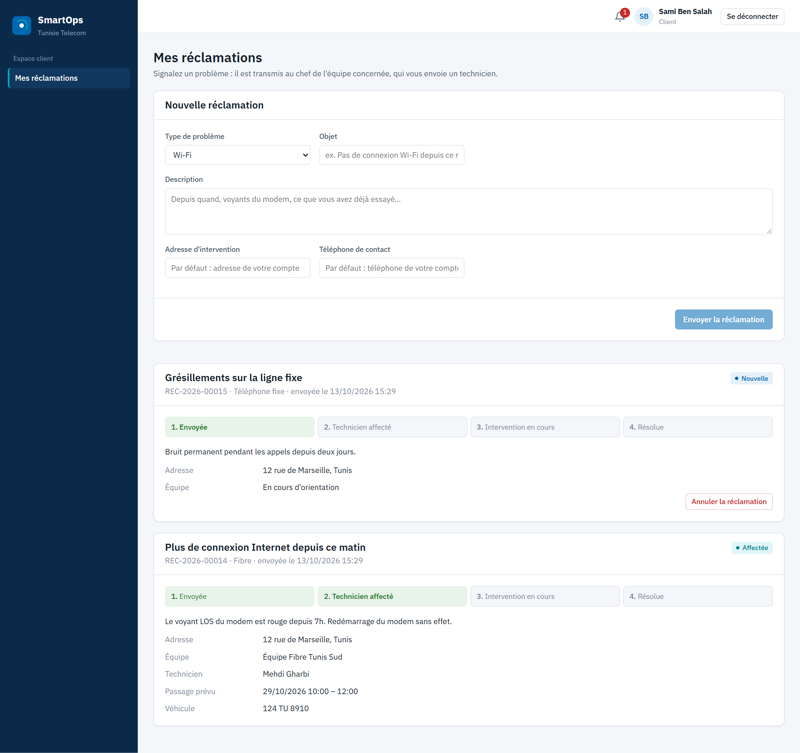
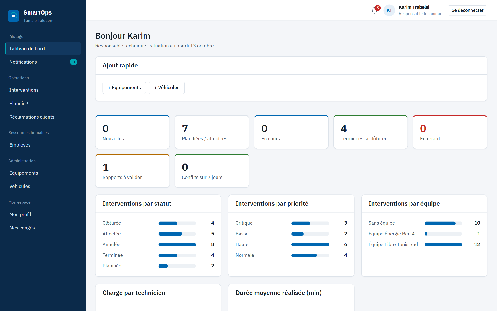
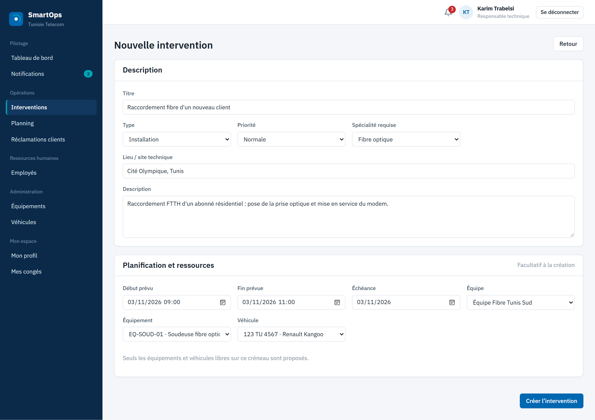
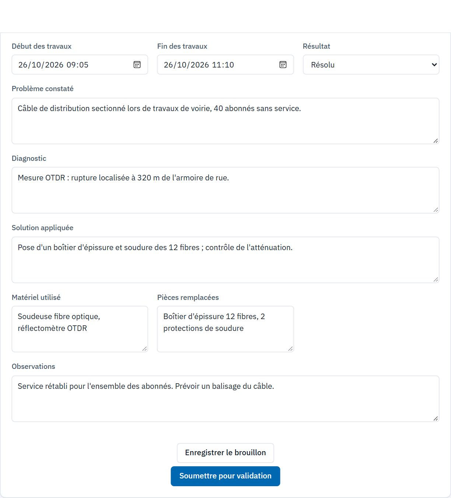
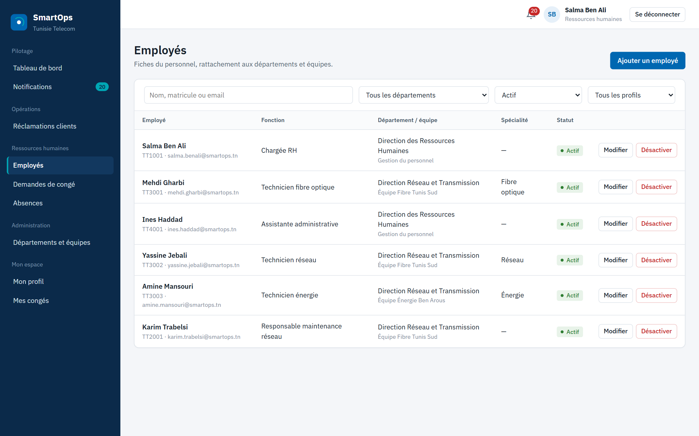

# TT SmartOps

Plateforme web de gestion des **interventions techniques** et des **ressources humaines** pour un opérateur
de télécommunications : planification sans conflit, suivi terrain jusqu'au rapport validé, et traitement des
réclamations clients.




## Pourquoi

Quand le planning, les congés et les réservations de matériel sont gérés séparément, un responsable peut
affecter un technicien qui sera en congé, ou réserver deux fois le même véhicule. TT SmartOps réunit ces
informations : la disponibilité d'un technicien est **calculée** à partir de ses congés, absences et autres
interventions, et chaque refus est expliqué avec ses motifs.

## Fonctionnalités

| Domaine | Ce que fait la plateforme |
|---|---|
| **Ressources humaines** | Employés (recherche, filtres, pagination), départements et équipes, congés avec calcul des jours ouvrés, absences |
| **Interventions** | Création, planification, affectation contrôlée, exécution (démarrer, suspendre, terminer), historique des statuts |
| **Ressources matérielles** | Équipements et véhicules réservés par créneau ; seules les ressources libres sont proposées |
| **Rapports** | Rédaction par le technicien, soumission après la fin, validation ou demande de correction |
| **Planning** | Vue semaine, détection des conflits apparus après coup (congé approuvé après affectation, double réservation) |
| **Espace client** | Inscription, dépôt de réclamation, routage vers l'équipe compétente, suivi en temps réel jusqu'à la résolution |
| **Pilotage** | Tableaux de bord par rôle, notifications internes, gestion des comptes, journal d'audit |

### Règles métier appliquées par le serveur

- Affectation refusée (HTTP 409, avec la liste des motifs) si le technicien est en congé ou absent, n'a pas la
  spécialité requise, ou a déjà une intervention sur le créneau.
- Congé refusé s'il chevauche une autre demande, commence dans le passé ou ne contient aucun jour ouvré ;
  le RH ne peut pas valider sa propre demande.
- Rapport soumis uniquement après la fin de l'intervention ; une demande de correction exige un commentaire.
- Cycle de vie défini une seule fois (`InterventionStatus.canTransitionTo`) et historisé.

## Captures d'écran

| Affectation d'un technicien | Suivi d'une réclamation (client) |
|---|---|
|  |  |
| **Tableau de bord** | **Nouvelle intervention** |
|  |  |
| **Rapport du technicien** | **Employés** |
|  |  |

## Architecture

```
Navigateur ──► Nginx (Angular) ──/api──► Spring Boot ──JDBC/TLS──► PostgreSQL
```

Monolithe modulaire : un package par domaine métier, chacun suivant
`Controller → DTO → Service (règles) → Repository → Entity`. Le schéma est géré exclusivement par Flyway.

| Couche | Choix |
|---|---|
| Frontend | Angular 18 (composants autonomes, signals), TypeScript, SCSS sans bibliothèque UI |
| Backend | Spring Boot 3.3, Java 21, Spring Data JPA |
| Sécurité | Spring Security, JWT HS256, BCrypt ; `@PreAuthorize` sur chaque endpoint |
| Base | PostgreSQL (Neon), migrations Flyway |
| Déploiement | Docker Compose, Nginx |

Détails, matrice des droits et modèle de données : [docs/ARCHITECTURE.md](docs/ARCHITECTURE.md).

## Démarrage

### Prérequis

- Une base PostgreSQL (par exemple [Neon](https://neon.tech), URL de connexion **directe**, non poolée)
- Docker Desktop, **ou** Java 21 + Maven et Node.js 20+

### Configuration

```bash
cp .env.example .env
```

Renseigner dans `.env` : `DB_URL`, `DB_USERNAME`, `DB_PASSWORD`, `JWT_SECRET` (`openssl rand -base64 48`),
`BOOTSTRAP_ADMIN_EMAIL` et `BOOTSTRAP_ADMIN_PASSWORD`. Le fichier `.env` n'est jamais versionné.

### Avec Docker

```bash
docker compose up --build -d
docker compose down
```

### Sans Docker (Windows)

```powershell
powershell -ExecutionPolicy Bypass -File .\start.ps1
```

Le script lance le backend et le frontend dans deux fenêtres. Manuellement :

```bash
cd backend && mvn spring-boot:run          # variables de .env exportées
cd frontend && npm install && npm start    # proxy /api -> localhost:8080
```

| Service | URL |
|---|---|
| Application | http://localhost:4200 |
| API | http://localhost:8080 |
| Swagger | http://localhost:8080/swagger-ui.html |

## Données de démonstration

Avec `DEMO_DATA_ENABLED=true` et `DEMO_PASSWORD` (10 caractères minimum), une base vide reçoit deux
départements, trois équipes, des équipements, des véhicules et six comptes, tous avec `DEMO_PASSWORD` :

| Rôle | Email |
|---|---|
| RH | `rh@smartops.tn` |
| Responsable technique (chef de l'équipe Fibre) | `responsable@smartops.tn` |
| Technicien fibre optique | `mehdi.gharbi@smartops.tn` |
| Technicien réseau | `yassine.jebali@smartops.tn` |
| Technicien énergie | `amine.mansouri@smartops.tn` |
| Employé | `ines.haddad@smartops.tn` |

Le compte administrateur est celui défini par `BOOTSTRAP_ADMIN_EMAIL`. Les clients créent leur compte depuis
la page d'inscription. À désactiver hors démonstration.

## Structure

```
backend/    API Spring Boot : un package par module métier
  src/main/resources/db/migration/   migrations Flyway
frontend/   Angular : core/ (auth, gardes, intercepteurs, services), shared/, layouts/, features/
docs/       architecture, règles métier, matrice des droits, captures
start.ps1   lancement local sans Docker
```

## Tests

- Tests unitaires : machine à états des interventions et calcul des périodes (`mvn test`).
- Campagne de bout en bout sur l'API : 139 vérifications (droits par rôle, règles de refus, cycle complet
  d'une intervention et d'une réclamation, entrées malveillantes).

## Limites connues

- Pas de pièces jointes (photos, justificatifs) ni de notification e-mail/SMS.
- Planning en vue semaine uniquement ; écran de consultation de l'audit à ajouter.
- Affectations simultanées d'un même technicien non verrouillées.

## Auteur

**Kamel Hamdi** : stage ingénieur ESPRIT (2025-2026) à Tunisie Telecom, Direction Régionale des
Télécommunications de Béja.
