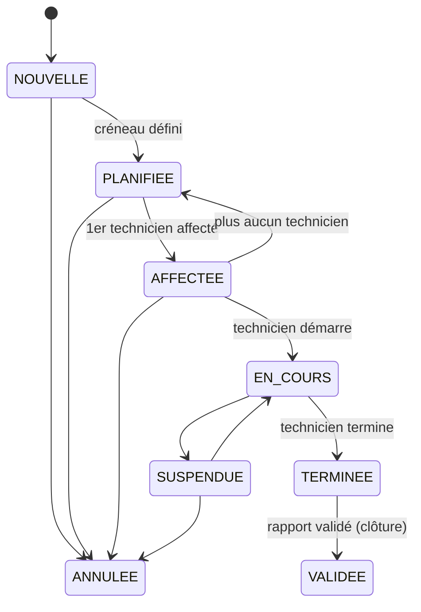
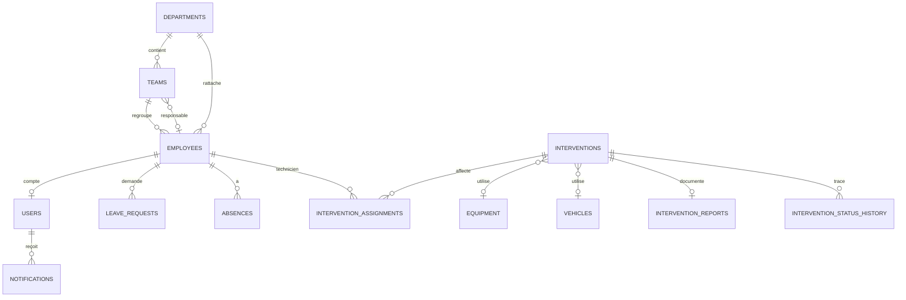

# TT SmartOps : architecture et état d'avancement

## 1. Point de départ

L'audit demandé en phase 1 portait sur un workspace existant. Aucun code n'ayant été fourni,
le projet a été construit à partir de zéro selon le cahier des charges. Ce document tient donc
lieu de référence d'architecture et de suivi des phases.

## 2. Architecture

Monolithe modulaire : un seul backend, découpé en packages métier indépendants. Pas de microservices,
de broker ni de cache : rien dans le besoin ne le justifie à ce stade.

```
Navigateur ──► Nginx (frontend Angular) ──/api──► Spring Boot ──JDBC/TLS──► PostgreSQL Neon
```

Chaque module backend suit la même chaîne : `Entity → Repository → Service (règles métier) → DTO → Controller`.
Les entités JPA ne sortent jamais des services. Le schéma est géré exclusivement par Flyway
(`ddl-auto: validate`).

| Couche | Choix | Justification |
|---|---|---|
| Sécurité | Spring Security stateless + JWT HS256, BCrypt(12) | Contrôle par `@PreAuthorize` sur chaque endpoint ; l'utilisateur est rechargé à chaque requête, donc un compte désactivé perd l'accès immédiatement |
| Erreurs | `GlobalExceptionHandler` | 404 introuvable, 409 conflit (avec liste détaillée), 422 règle métier, 400 validation par champ |
| Audit | Table `audit_logs` alimentée par `AuditService` | Écrit dans la transaction métier : pas de trace d'une opération annulée |
| Disponibilité | Calculée (`AvailabilityService`) | Jamais stockée en booléen : congés approuvés + absences + interventions bloquantes |
| Frontend | Composants standalone, signals, SCSS sans bibliothèque UI | Moins de dépendances, thème Tunisie Telecom maîtrisé |

## 3. Matrice des droits (appliquée côté backend)

| Fonction | ADMIN | RH | RESP. TECH. | TECHNICIEN | EMPLOYÉ |
|---|:-:|:-:|:-:|:-:|:-:|
| Comptes utilisateurs, journal d'audit | ✔ | | | | |
| Employés : consulter | ✔ | ✔ | ✔ | | |
| Employés : créer, modifier, activer/désactiver | | ✔ | | | |
| Départements / équipes : gérer | ✔ | ✔ | lecture | | |
| Congés : demander, annuler les siens | | ✔ | ✔ | ✔ | ✔ |
| Congés : approuver / refuser (sauf les siens) | | ✔ | | | |
| Absences : enregistrer | | ✔ | lecture | | |
| Interventions : créer, planifier, affecter, annuler | | | ✔ | | |
| Interventions : consulter | ✔ | | ✔ | les siennes | |
| Interventions : démarrer, suspendre, terminer | | | suspendre | les siennes | |
| Rapport : rédiger, soumettre | | | | les siens | |
| Rapport : valider / demander correction | | | ✔ | | |
| Équipements, véhicules | ✔ | | ✔ | | |
| Planning global et conflits | ✔ | | ✔ | le sien | |

## 4. Cycle de vie d'une intervention



La machine à états est définie une seule fois (`InterventionStatus.canTransitionTo`) ; chaque transition est
historisée dans `intervention_status_history`.

## 5. Règles métier implémentées

**Affectation d'un technicien** (refusée avec la liste des motifs, HTTP 409) : intervention planifiée ;
fiche marquée technicien et active ; spécialité conforme si exigée ; aucun congé approuvé ni absence sur
la période ; aucune autre intervention bloquante qui chevauche le créneau. L'écran d'affectation affiche
pour chaque technicien ses conflits et une frise de la journée ; la décision reste au responsable.

**Replanification** : changer le créneau d'une intervention déjà affectée revérifie tous les techniciens,
l'équipement et le véhicule, puis notifie les techniciens.

**Équipements et véhicules** : réservation impossible si `EN_MAINTENANCE` / `HORS_SERVICE` ou si une autre
intervention bloquante les utilise sur un créneau qui chevauche. Statut `AFFECTE` posé au démarrage,
`DISPONIBLE` à la fin ou à l'annulation.

**Congés** : dates cohérentes ; pas de début dans le passé (sauf maladie) ; au moins un jour ouvré ;
pas de chevauchement avec une demande en attente ou approuvée ; on ne traite pas sa propre demande ;
seule une demande en attente est traitée ou annulée.

**Rapport** : rédigé uniquement par un technicien affecté, une fois l'intervention démarrée ; soumission
après `TERMINEE` avec diagnostic, solution, résultat et horaires ; validation = clôture de l'intervention ;
une demande de correction exige un commentaire.

**Détection de conflits sur le planning** (`GET /api/planning/conflicts`) : double affectation, intervention
pendant un congé ou une absence (ex. congé approuvé après l'affectation), double réservation d'équipement
ou de véhicule.

## 6. Modèle de données



`audit_logs` est volontairement découplée (pas de clé étrangère) pour survivre à toute suppression.

## 7. État d'avancement par phase

| Phase | Backend | Frontend |
|---|---|---|
| 2-3 Architecture, Neon, Flyway | fait | fait |
| 4 Auth JWT, rôles, admin initial | fait (+ gestion des comptes `/api/users`) | connexion, garde par rôle, menu par rôle |
| 5 Employés | fait (recherche, filtres, tri, pagination) | liste + formulaire |
| 6 Départements, équipes | fait | fait (départements, équipes, membres, catégories de réclamations) |
| 7 Congés | fait | mes congés + traitement RH |
| 8 Absences | fait | fait |
| 9-10 Interventions, affectation, disponibilité | fait | liste, formulaire, détail, panneau d'affectation |
| 11 Planning | fait (entrées, conflits, frise journalière) | vue semaine (**jour / mois à ajouter**) |
| 12-13 Équipements, véhicules | fait | fait (gestion + ressources libres proposées selon le créneau) |
| 14 Rapports | fait (sans pièces jointes) | fait |
| 15 Notifications | fait (internes) | fait (compteur rafraîchi toutes les 30 s) |
| — Réclamations clients | fait (routage par catégorie, statut synchronisé avec l'intervention) | espace client + boîte du chef d'équipe |
| 16 Tableaux de bord | fait, par rôle | fait (graphiques en barres CSS) |
| 17 Audit | fait | **écran de consultation à faire** |
| 18 Tests | 2 classes de tests unitaires + campagne de bout en bout sur l'API (139 vérifications) | **à faire** |
| 19 Docker | fait | fait |
| 20 Documentation | ce document | |

## 8. Points d'attention

- La base Neon est distante : une coupure réseau rend l'application indisponible le temps de la coupure.
  Le pool de connexions sonde et renouvelle ses connexions (`application.yml`) pour éviter les erreurs
  après une période d'inactivité.
- Le jeton est en `sessionStorage` ; un passage en cookie `HttpOnly` réduirait l'exposition XSS.
- Les pièces jointes (photos, justificatifs) ne sont pas implémentées : prévoir un stockage fichier
  (volume ou objet) avec contrôle de type, taille et droits d'accès.
- La concurrence (deux responsables affectant le même technicien au même instant) n'est pas verrouillée ;
  une contrainte d'exclusion PostgreSQL ou un verrou pessimiste sur le technicien le réglerait.
- Tests prioritaires à écrire : `InterventionService.assign` (chaque motif de refus), `LeaveService.decide`,
  `PlanningService.detectConflicts`, et des tests d'accès `@WebMvcTest` par rôle.
